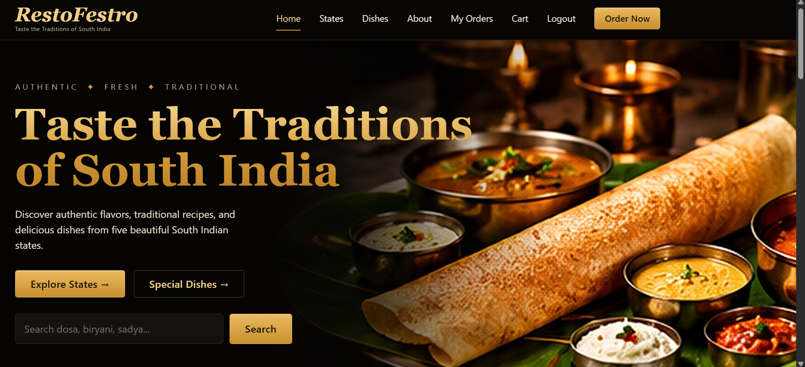
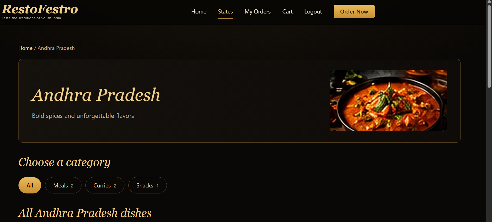
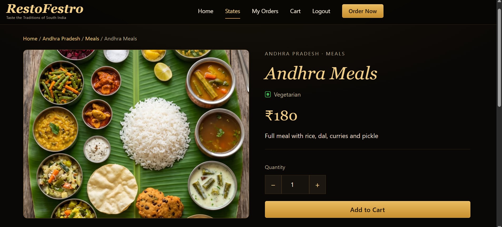
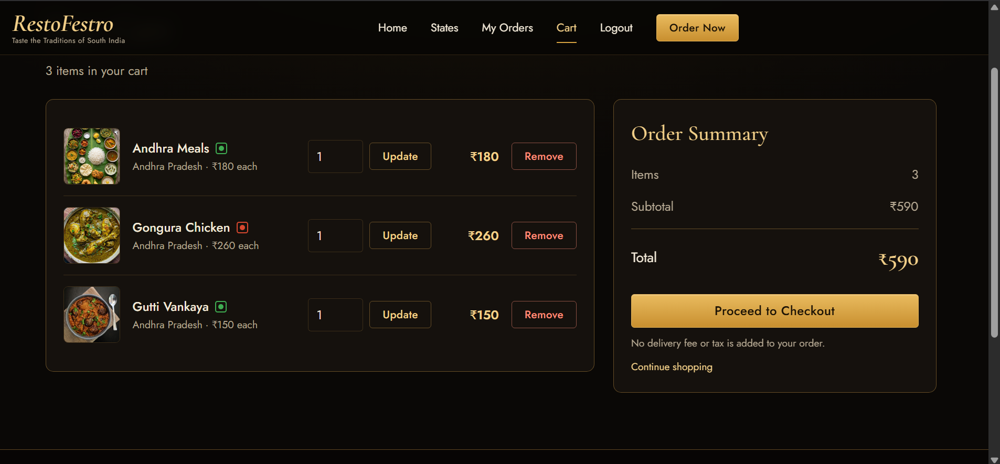
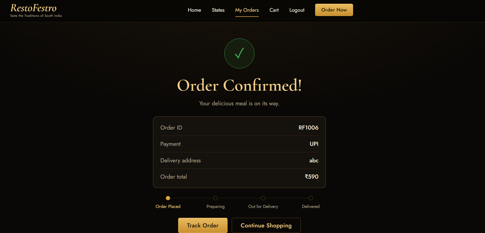
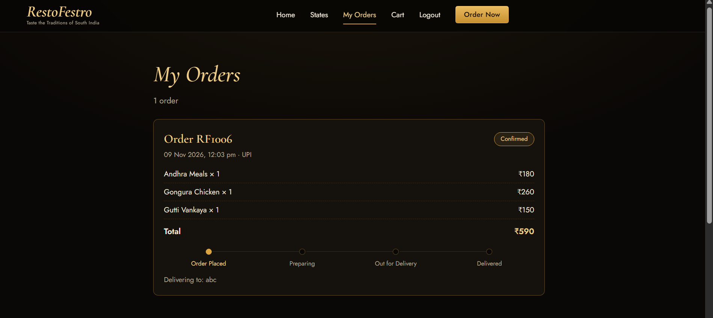
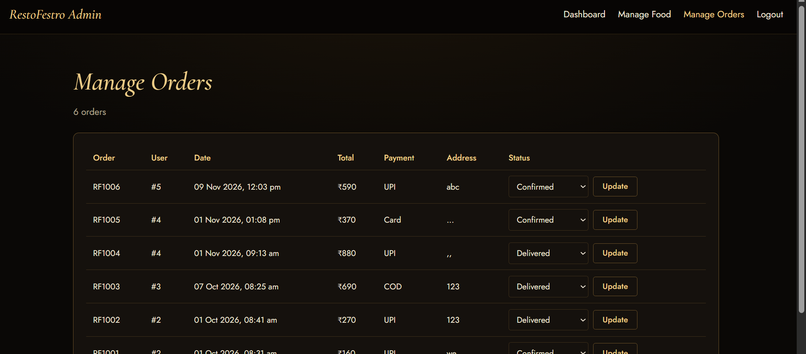

# 🍽️ RestoFestro – Taste the Traditions of South India

RestoFestro is a web-based food ordering application developed to make exploring and ordering traditional South Indian food easier. Instead of browsing through a general food menu, users can explore dishes based on five South Indian states: **Andhra Pradesh, Telangana, Karnataka, Tamil Nadu, and Kerala.**

The main idea behind this project is to bring different regional food varieties together in one place, allowing users to discover dishes, view their details, add items to their cart, and place orders.

I developed this project using **Core Java, Servlets, JDBC, MySQL, HTML, CSS, and JavaScript**, without using any frameworks. The application runs on Apache Tomcat 10.1.



## ✨ Features

### Customer Features
- **User Registration and Login:** Users can create an account, log in, and log out securely using session management.
- **Explore Regional Food:** Browse dishes by selecting a state and then choosing a food category.
- **Search Dishes:** Find food items easily using the search option.
- **Food Details:** View dish images, prices, veg/non-veg information, and suggested similar dishes.
- **Shopping Cart:** Add items, update quantities, remove dishes, and view the total amount.
- **Checkout:** Enter delivery details and choose a simulated payment option (UPI, Card, or Cash on Delivery).
- **Order Confirmation:** Receive confirmation after placing an order.
- **Order History:** View previously placed orders and track their current status.

### Admin Features
- Separate admin login with session management.
- Add new food items along with their photos.
- Update or change existing dish photos.
- Delete food items from the menu.
- View all customer orders.
- Update order statuses, which are reflected in the customer's order tracking page.

## 📸 Screenshots

### Exploring Food

| State Menu | Dish Details |
|---|---|
|  |  |

### Ordering Process

| Shopping Cart | Order Confirmation |
|---|---|
|  |  |

### Order Management

| My Orders | Admin Order Management |
|---|---|
|  |  |

## 🛠️ Technologies Used

| Layer | Technology |
|---|---|
| Frontend | HTML5, CSS3, JavaScript |
| Backend | Core Java, Jakarta Servlets |
| Database Connectivity | JDBC, PreparedStatement |
| Database | MySQL 8 |
| Server | Apache Tomcat 10.1 |
| IDE | Eclipse IDE for Enterprise Java |

## 🏗️ Project Architecture

The application follows a simple three-layer architecture. Each layer has its own responsibility, which makes the code easier to understand and maintain.

```text
Browser (HTML / CSS / JavaScript)
              |
              v
          Servlets
       (Controller Layer)
              |
              v
             DAO
        (Database Layer)
              |
              v
            MySQL
```

### Project Structure

```text
com.restofestro
│
├── controller/
│   ├── LoginServlet
│   ├── RegisterServlet
│   ├── FoodServlet
│   ├── FoodDetailsServlet
│   ├── CartServlet
│   ├── CheckoutServlet
│   ├── OrderServlet
│   ├── DishImageServlet
│   └── LogoutServlet
│
├── admin/
│   ├── AdminLoginServlet
│   ├── AdminFoodServlet
│   ├── AdminOrderServlet
│   └── AdminLogoutServlet
│
├── dao/
│   ├── UserDAO
│   ├── FoodDAO
│   ├── CartDAO
│   ├── OrderDAO
│   └── AdminDAO
│
├── model/
│   ├── User
│   ├── Food
│   └── Order
│
└── util/
    ├── DBConnection
    ├── PasswordUtil
    ├── PageUtil
    └── UploadUtil
```

## 🗄️ Database Design

The project uses MySQL with six main tables:

- `users` – Stores customer information.
- `admins` – Stores administrator login details.
- `food` – Stores food items, prices, categories, and state information.
- `cart` – Stores items added to the shopping cart.
- `orders` – Stores customer order details.
- `order_items` – Stores individual food items belonging to each order.

State and category information are maintained in the `food` table, making it easier to retrieve dishes based on the selected state and category.

When a customer places an order, the order details and corresponding order items are saved together using a **database transaction**.

## 🚀 How to Run the Project

### Prerequisites

Make sure the following are installed:

- JDK 17 or above
- Eclipse IDE for Enterprise Java
- Apache Tomcat 10.1
- MySQL 8
- MySQL Connector/J
- Git (to clone the repository)

### Setup Instructions

1. Clone the repository:

   ```bash
   git clone https://github.com/Kruthika-18/RestoFestro.git
   ```

2. Open MySQL Workbench and execute the SQL file:

   ```text
   database/restofestro_schema.sql
   ```

   This creates the database tables and inserts 30 sample dishes along with a default admin account.

   > ⚠️ **Warning:** the script starts with `DROP DATABASE IF EXISTS restofestro`, so it deletes any existing database with that name. Run it only on a fresh setup.

3. Download MySQL Connector/J and place the JAR file inside:

   ```text
   src/main/webapp/WEB-INF/lib/
   ```

4. Open `util/DBConnection.java` and update the MySQL username and password with your local database credentials.

5. In Eclipse, choose **File → Import → Maven → Existing Maven Projects** and select the cloned folder.

6. Configure Apache Tomcat 10.1 in Eclipse.

7. Right-click the project and select **Run As → Run on Server**.

8. Open the application in your browser:

   ```text
   http://localhost:8080/RestoFestro/
   ```

> Photos uploaded from the admin panel are saved in a `restofestro-uploads` folder inside your user folder (for example `C:\Users\<you>\restofestro-uploads`), not inside the project.

### Default Admin Login

For local testing only:

- **Login Page:** `/RestoFestro/admin/admin-login.html`
- **Email:** `admin@restofestro.com`
- **Password:** `admin123`

## 🔐 Security Implementations

Some basic security practices have been included in the project:

- Used `PreparedStatement` to prevent SQL injection.
- Passwords are hashed using SHA-256 before storing them in the database.
- Session validation is implemented for protected customer pages.
- Admin authentication is handled separately using an `adminId` session attribute.
- HTML output is escaped using `PageUtil.esc` to reduce the risk of cross-site scripting.
- Uploaded images are limited to 3 MB and checked for JPG, PNG, and WEBP file signatures.
- Uploaded photos are stored outside the web application folder.

## ⚠️ Limitations and Future Improvements

There are still a few areas where the project can be improved:

- Integrate a real payment gateway instead of simulated payments.
- Replace plain SHA-256 password hashing with a stronger password-hashing algorithm such as BCrypt.
- Add features like coupons, favourites, and customer reviews.
- Write unit tests to improve application reliability.
- Migrate the application to Spring Boot.
- Deploy the application online so that users can access it.

## 👩‍💻 About the Project

RestoFestro is a learning project that I developed to gain practical experience in full-stack Java web development.

While building this application, I got hands-on experience with Java Servlets, JDBC, MySQL database operations, session management, CRUD operations, file uploads, and database transactions.

One of the main things I learned was how the frontend, backend, and database work together to complete a real-world ordering process.

**Built with ❤️ using Core Java and MySQL.**
